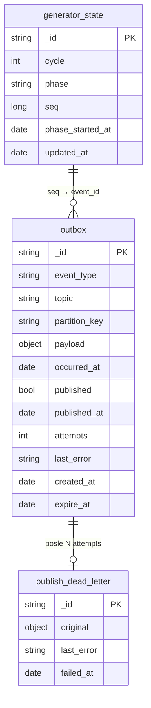

# 5. MongoDB (Computer-A)

Mongo je **ingest store** za Outbox pattern, ne sistem evidencije vozača. Computer-B **ne** čita Mongo. Ako broker padne, neobjavljeni dokumenti čekaju u `outbox`.

Baza: `fleetrelay`. Auth: root user iz compose-a, URI sa `authSource=admin` (vidi `env.a.example`).

Init indeksi: [`deploy/mongo-init.js`](../deploy/mongo-init.js). Radi samo pri **prvom** kreiranju volumena. Go pri startu sme da uradi `CreateMany` istih indeksa (idempotentno).

## 5.1 „ER“ — dokumenti i veze

Mongo nema FK. Logičke veze:



`outbox._id` = `event_id` = Kafka envelope `event_id` = (kasnije) `processed_events.event_id` na B. To je **jedini** join ključ kroz ceo sistem.

## 5.2 Kolekcija `outbox`

### Polja

| Polje | Tip | Obavezno | Značenje |
|---|---|---|---|
| `_id` | string | da | = `event_id` (ULID ili UUID v5). PK = idempotencija inserta |
| `event_type` | string | da | `driver.heartbeat` \| `verification.submitted` \| `vehicle.classify.requested` |
| `topic` | string | da | Kafka topic |
| `partition_key` | string | da | `driver_id` ili `vehicle_id` |
| `payload` | object | da | envelope (poglavlje 8), sme biti ugnježden ceo JSON |
| `occurred_at` | date | da | vreme eventa |
| `published` | bool | da | `false` dok publisher ne potvrdi Kafka |
| `published_at` | date \| null | | |
| `attempts` | int | da | broj produce pokušaja |
| `last_error` | string \| null | | |
| `created_at` | date | da | vreme upisa u Mongo |
| `expire_at` | date \| null | | setuje se **tek kad** `published=true`; TTL indeks briše dokument |

TTL indeks `{ expire_at: 1 }` sa `expireAfterSeconds: 0` briše dokument u trenutku `expire_at`. Predlog: `published_at + 48h`. Neobjavljeni **nemaju** `expire_at` — ne smeju da ispare.

### Indeksi

| Ime | Spec | Namena |
|---|---|---|
| `_id_` | default | idempotent insert |
| `outbox_unpublished_fifo` | `{ published: 1, created_at: 1 }` | publisher: FIFO unpublished |
| `outbox_type_time` | `{ event_type: 1, created_at: -1 }` | debug / metrika po tipu |
| `outbox_ttl` | `{ expire_at: 1 }` TTL 0s | čišćenje diska posle burst-a |

### Primer dokumenta

```json
{
  "_id": "01JABC…",
  "event_type": "driver.heartbeat",
  "topic": "fleet.heartbeat.v1",
  "partition_key": "3d6f0a3e-…",
  "payload": {
    "event_id": "01JABC…",
    "event_type": "driver.heartbeat",
    "occurred_at": "2026-09-20T12:00:00.123Z",
    "partner_id": "…",
    "driver_id": "3d6f0a3e-…",
    "payload": { "lat": 44.812, "lng": 20.461, "speed_kmh": 28 }
  },
  "occurred_at": { "$date": "2026-09-20T12:00:00.123Z" },
  "published": false,
  "published_at": null,
  "attempts": 0,
  "last_error": null,
  "created_at": { "$date": "2026-09-20T12:00:00.124Z" },
  "expire_at": null
}
```

### Operacije (ekvivalent „SQL upita“)

Insert batch (Fan-In flusher), idempotent:

```javascript
db.outbox.bulkWrite(
  docs.map((d) => ({
    insertOne: {
      document: d,
    },
  })),
  { ordered: false }
);
// Duplicate key na _id = već viđen event_id → ignoriši.
```

Publisher poll:

```javascript
db.outbox.find({ published: false })
  .sort({ created_at: 1 })
  .limit(2000);
```

Posle uspešnog Kafka batch-a:

```javascript
db.outbox.updateMany(
  { _id: { $in: ids } },
  {
    $set: {
      published: true,
      published_at: new Date(),
      expire_at: new Date(Date.now() + 48 * 3600 * 1000),
      last_error: null,
    },
  }
);
```

Neuspeh jednog batch-a:

```javascript
db.outbox.updateMany(
  { _id: { $in: ids } },
  { $inc: { attempts: 1 }, $set: { last_error: err } }
);
```

Posle `attempts >= 8` (konfig): prebaci u `publish_dead_letter`, obriši ili označi da ne blokira FIFO. Heartbeat sme u DLQ; verification **ne** sme tiho da nestane — ostaje unpublished i alarm.

**Zabranjeno:** jedan `insertOne` po eventu u vrućoj petlji na 20k/s. **Zabranjeno:** prvo Kafka pa Mongo (to nije outbox).

## 5.3 Kolekcija `generator_state`

Jedan dokument `_id: "scheduler"` da producer preživi restart usred ciklusa.

```json
{
  "_id": "scheduler",
  "cycle": 1,
  "phase": "burst_1",
  "seq": 1234567,
  "burst_rate": 20000,
  "phase_started_at": { "$date": "…" },
  "updated_at": { "$date": "…" }
}
```

`phase`: `burst_1` | `idle_1` | `burst_2` | `idle_2` | `burst_3` | `cycle_pause`.

`seq` monotono raste; `event_id` sme da se izvede iz `seq` (ULID sa entropijom ili UUID v5(`seq`)) radi idempotencije.

Upsert svakih N ms, ne svaki event:

```javascript
db.generator_state.updateOne(
  { _id: "scheduler" },
  { $set: { seq: n, phase: p, updated_at: new Date() } },
  { upsert: true }
);
```

## 5.4 Kolekcija `publish_dead_letter`

```json
{
  "_id": "01J…",
  "original": { "...ceo outbox dokument..." },
  "last_error": "kafka: ...",
  "failed_at": { "$date": "…" }
}
```

## 5.5 Šta Mongo namerno nema

- Kolekciju `drivers` — to je Postgres.
- Change Streams u CORE-u — polling unpublished je dovoljan i predvidiv pod loadom. Change Stream je EXTENDED alternativa.
- Replica set na A — jedan node; transakcije multi-doc nisu potrebne ako je outbox jedan dokument po eventu.

## 5.6 Ručna provera

```powershell
docker exec -it fleetrelay-mongo mongosh -u fleetrelay -p fleetrelay --authenticationDatabase admin
```

```javascript
use fleetrelay
db.outbox.getIndexes()
db.outbox.countDocuments({ published: false })
db.outbox.find().sort({ created_at: -1 }).limit(1).pretty()
```
