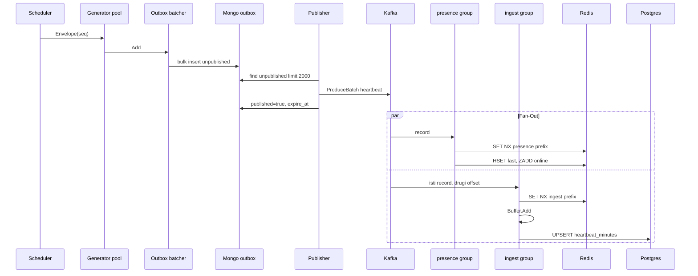
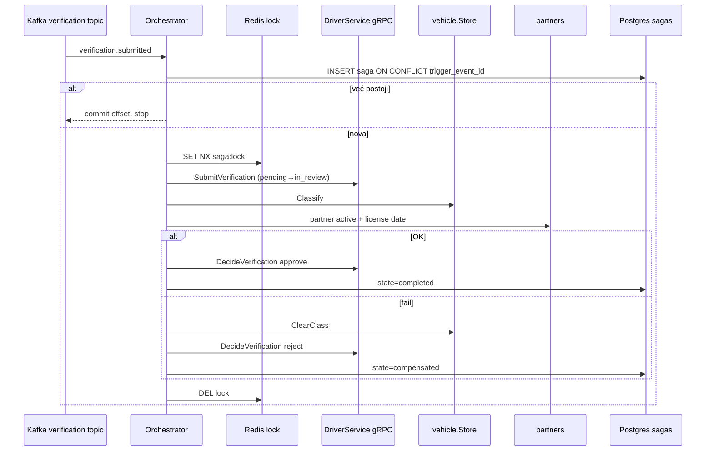

# 8. Tokovi, patterni, ugovori poruka

## 8.1 Raspored patterna

| Pattern | Računar | Kod | Okidač |
|---|---|---|---|
| Outbox | A | `internal/outbox` | svaki dummy event |
| Outbox | B (EXTENDED) | tabela `outbox_events` | saga ishod |
| Worker Pool | A | `platform/pool` | generatori |
| Worker Pool | B | `platform/pool` | **samo** SAGA envelope-i |
| Fan-In | A | `batcher` → Mongo bulk | N generatora → 1 write |
| Fan-In | B | `heartbeat.Buffer` → UPSERT | N pings → 1 SQL |
| Fan-Out | A | Kafka partitions | key = driver_id |
| Fan-Out | B | 2 consumer grupe na heartbeat + in-process Redis pipeline | ista poruka, dva offset stream-a |
| Idempotency | A | `outbox._id = event_id` | retraj generatora |
| Idempotency | B | Redis NX per group + `sagas.trigger_event_id` UNIQUE | Kafka replay, WiFi |
| SAGA | B | `internal/saga` | `verification.submitted` |

## 8.2 Tok dummy eventa (A → B), heartbeat



## 8.3 Tok SAGA (verification)



Choreography preko 4 topic-a **nije** CORE. Orchestrator je jasniji za 40–60h i lakši za test. U README napiši: na skali bi koraci 2–3 mogli biti poruke, uz outbox na B.

## 8.4 Envelope JSON (kanonski)

Heartbeat:

```json
{
  "event_id": "01J9Z…",
  "event_type": "driver.heartbeat",
  "occurred_at": "2026-09-20T14:05:03.123Z",
  "partner_id": "aaaaaaaa-bbbb-5ccc-dddd-eeeeeeeeeee0",
  "driver_id": "aaaaaaaa-bbbb-5ccc-dddd-eeeeeeeeeee1",
  "payload": { "lat": 44.8123, "lng": 20.4611, "speed_kmh": 31.5 }
}
```

Verification:

```json
{
  "event_id": "01J9Y…",
  "event_type": "verification.submitted",
  "occurred_at": "2026-09-20T14:05:03.500Z",
  "partner_id": "…",
  "driver_id": "…",
  "vehicle_id": "…",
  "payload": {
    "license_no": "LIC-42",
    "license_expires_at": "2027-01-15"
  }
}
```

Classify (0.5% mix, ili korak SAGA-e bez posebnog Kafka eventa u CORE-u):

```json
{
  "event_id": "01J9X…",
  "event_type": "vehicle.classify.requested",
  "occurred_at": "2026-09-20T14:05:04.000Z",
  "partner_id": "…",
  "driver_id": "…",
  "vehicle_id": "…",
  "payload": { "seats": 4, "year": 2021 }
}
```

Ako SAGA sama zove `Classify` iz seed-ovanih `seats/year` u Postgres-u, topic `fleet.vehicle.classify.v1` sme da ostane za ručne/demo evente. Mix 0.5% i dalje sme da ga puni da se vidi consumer.

## 8.5 REST ugovor (sažetak)

Base: `http://<B>:8080`.

| | Request | Response 200 |
|---|---|---|
| `GET /v1/drivers/{id}` | | `{ "driver": {…postgres }, "last": {…redis ili null}, "online": bool }` |
| `GET /v1/presence` | | `{ "online": 1234, "stale_seconds": 30 }` |
| `GET /v1/reports/summary` | | snapshot JSON |
| `GET /v1/sagas/{id}` | | saga + steps |

4xx: `illegal_transition` 409, `not_found` 404, `bad_request` 400.

Nema public POST za 20k/s. Load ide isključivo kroz producer.

## 8.6 Failure načini (očekivano ponašanje)

| Failure | Šta se dešava | Šta ne sme |
|---|---|---|
| Kafka down na A | outbox unpublished raste, generator sme da uspori na `ErrFull` | gubitak event_id (Mongo ih čuva) |
| Mongo down | generator staje (nema outbox) | pisanje direktno u Kafka „privremeno“ |
| Redis down na B | presence/dedup fail; consumer ne commituje (retry) | tiho preskakanje SAGA-e |
| Postgres down | ingest buffer raste u memoriji do max pa `ErrFull`; SAGA staje | 20k INSERT retry petlja |
| WiFi drop B | lag raste; posle reconnect replay → NX | dupli `verified` |
| Dupli event_id sa A | Mongo dup key ignore; B NX hit | druga SAGA |

## 8.7 Odluke koje moraš umeti da kažeš (2–3 rečenice)

1. Zašto Mongo outbox a ne „samo Kafka“.
2. Zašto heartbeat nije SAGA.
3. Zašto dve consumer grupe umesto jednog handlera sa dva poziva (nezavisan lag i retry).
4. Zašto Postgres rollup a ne raw GPS.
5. Zašto gRPC samo za Driver, ne za heartbeat.
6. Zašto 2 procesa × 2 mašine, ne 4 mikroservisa.
7. Šta meriš kad 20k/s ne stoji (outbox depth vs consumer lag vs Redis pipeline vs WiFi).
